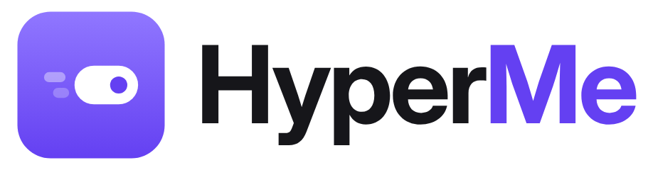
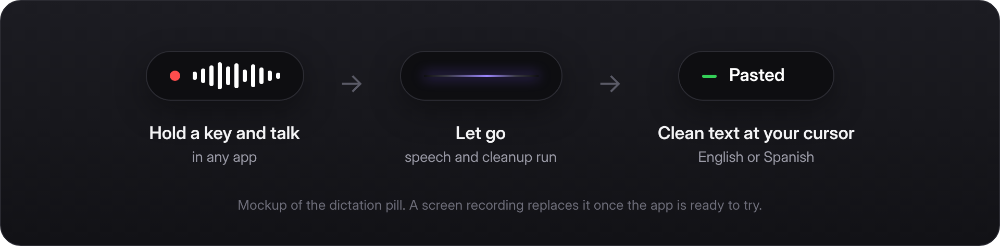

<div align="center">

<picture>
  <source media="(prefers-color-scheme: dark)" srcset="docs/brand/hyperme-logo-dark.png">
  
</picture>

### The open-source voice copilot for your workday

Hold a key, speak, and get it done: clean text in any app today; answers, previewed actions,
your day and your mail next. Light, native, and on your own keys.

[](https://github.com/AndresHG/hyperme/actions/workflows/ci.yml)
[](#licence)
[](#quick-start)
[](#roadmap)
[](docs/SPEC.md)

[Quick start](#quick-start) · [Features](#features) · [Roadmap](#roadmap) ·
[Contributing](#contributing) · [Documents](#documents)

<br>



</div>

> [!IMPORTANT]
> **Pre-alpha. There is no release to install yet.** You can build a development version on your
> Mac (below). Phase 0, the speed and quality test, has not passed its gate yet: see the
> [roadmap](#roadmap).

## What it is

HyperMe is one small pill at the bottom of your screen for everything you say at work. It starts
with dictation: hold a key, speak in English or Spanish, and clean text lands at your cursor in
any app. Then the same key grows into a copilot. Say "Hyper, open a ticket for this" and it
prepares the action and shows you a preview before anything leaves your Mac. Ask a short question
and get a short answer. Your day, your tasks and your mail drafts in one place, and later your
meetings turned into notes and tickets.

Dictation apps turn voice into text. HyperMe aims to turn voice into an outcome: text, an answer,
an action or a task.

## Features

**Working now, in the development build**

- 🎙️ **Hold-to-talk dictation in any app.** Hold Fn (or Right Option, or a chord), speak, let go.
  Speech streams while you talk, a small fast model cleans it up, and the text is pasted at your
  cursor with your clipboard restored. Esc cancels.
- 🌍 **English and Spanish**, detected per dictation and never translated.
- 🛟 **Nothing lost.** Every dictation's audio is saved on your Mac while you speak, so a dropped
  connection can be retried. History is kept for 30 days by default, under a size limit you set.
- 🔑 **Your keys, your providers.** Speechmatics for speech and Groq for cleanup to start, behind
  traits so others can be added. Keys live in the macOS keychain, never in files or logs.
- 🔒 **Private by design.** Audio, the transcript, your dictionary, the app name and the text before
  the cursor may go to the providers you configured, and nothing else does. Never password fields.
  No telemetry.

**Planned, phase by phase** (see the [roadmap](#roadmap))

- 📖 A personal dictionary learned from your corrections, cleanup levels and tone per app.
- 💬 "Hyper, …" on the same key: short answers in a card, and actions in your tools through MCP,
  starting with GitHub. Every action shows a preview and waits for Enter.
- ✅ A daily task list ("Hyper, remind me to …"), a morning card, calendar nudges, and email
  triage with **draft-only** replies. Google first.
- 🗒️ Meetings transcribed on your Mac, ending as notes and proposed tickets with an owner and the
  exact quote.
- 🧠 Memory you control: "Hyper, remember …", kept as plain Markdown files on your Mac.

## Why HyperMe

- **Open.** A small native app you can read, under MIT OR Apache-2.0.
- **Yours.** Your keys and your choice of providers; you pay them per use, with no subscription in
  between. Your audio and history stay on your Mac.
- **Light.** A Rust core in Tauri 2, not a browser bundle. The targets are under 100 MB of memory
  and near 0% CPU when idle, and under 800 ms from key release to cleaned text.
- **Safe actions.** Anything that creates, sends or posts outside the app shows a preview first.
  Email is never sent, only drafted.

These are design targets. Measured numbers, with date, machine and network, are in
[docs/results/](docs/results/); claims we have not earned yet are tracked in the
[claims ledger](docs/PITCH.md#claims-ledger).

## Quick start

You need macOS, a Rust toolchain, and two API keys:
[Speechmatics](https://www.speechmatics.com/) (speech) and [Groq](https://groq.com/) (cleanup).

```sh
git clone https://github.com/AndresHG/hyperme.git
cd hyperme
scripts/create-signing-identity.sh   # once: a local signing identity, so permissions survive rebuilds
scripts/bundle-macos.sh              # builds HyperMe.app into ~/Applications
open ~/Applications/HyperMe.app
```

The walkthrough asks for the microphone, Accessibility and Input Monitoring, then for your two
keys, and tests each step. This is a local, unnotarised build for trying HyperMe; a signed release
comes later. `cargo run` works too, but then macOS gives the permissions to your terminal app.

**Just want to measure speed on your own voice?** `spikes/flowbench` times key release to cleaned
text on your recordings, and runs with fake providers if you have no keys. See
[its README](spikes/flowbench/README.md).

## Roadmap

Each phase starts only after the gate of the one before it passes. Full plan and gates:
[docs/ROADMAP.md](docs/ROADMAP.md).

| Phase | Goal | State |
| --- | --- | --- |
| **0. Speed test** | Prove dictation speed and quality on real recordings, measured beside Wispr Flow | 🟡 In progress. Speed and language meet the gate; quality does not yet ([results](docs/results/2026-11-26-wispr-comparison.md)) |
| **1. Dictation core** | A menu-bar app good enough for daily dictation | 🟡 Being built: [draft spec](specs/25-dictation-core/spec.md), development build above |
| **2. Quality and first release** | Personal dictionary, cleanup levels, a signed build others can install | ⚪ Planned |
| **3. Smart routing and actions** | One key for dictation, questions and previewed actions; GitHub first | ⚪ Planned |
| **4. Daily tasks and email** | Task list, calendar, draft-only email, Google first | ⚪ Planned |
| **5. Meetings** | Meetings on device, ending as notes and tickets | ⚪ Planned |
| **Later** | Local models, Linux and Windows, a wake word, handing a task to Claude Code | ⚪ Ideas |

HyperMe is a personal copilot for daily work, not a coding assistant. What it will not do is
listed in [docs/PRD.md](docs/PRD.md#8-non-goals).

## Contributing

Contributions are welcome, and the project is young enough that early feedback shapes it.

- Read [CONTRIBUTING.md](CONTRIBUTING.md). Every change is sized S, M or L; every change starts
  from a failing test, and L-sized changes start from a spec in [specs/](specs/).
- Tests never call a paid API or need a key; they use local fakes.
- Before a pull request: `cargo fmt`, `cargo clippy --all-targets -- -D warnings` and `cargo test`.
- Dependencies must be MIT, Apache-2.0 or BSD (`deny.toml`). Never copy GPL code.
- Please follow the [code of conduct](CODE_OF_CONDUCT.md), and report security problems privately
  as described in [SECURITY.md](SECURITY.md).

Look for issues labelled
[`good first issue`](https://github.com/AndresHG/hyperme/issues?q=is%3Aissue+is%3Aopen+label%3A%22good+first+issue%22),
or open one to say what you would like HyperMe to do.

## Documents

| | |
| --- | --- |
| [Product (PRD)](docs/PRD.md) | What HyperMe is, for whom, and in what order |
| [Roadmap](docs/ROADMAP.md) | Phases, gates, and where we stand |
| [Spec](docs/SPEC.md) | Requirements, architecture, budgets and safety rules |
| [UX](docs/UX.md) | The pill, cards, Home window and settings, with mockups |
| [Pitch](docs/PITCH.md) | Positioning, and the ledger of claims still to earn |
| [The field](docs/FIELD.md) | Other projects, and what we learn from each |
| [Brand](docs/brand/README.md) | The logo and how to use it |
| [Changelog](CHANGELOG.md) · [Notice](NOTICE.md) | Changes, and borrowed work |

## Licence

Licensed under either of [MIT](LICENSE-MIT) or [Apache-2.0](LICENSE-APACHE), at your option.
Unless you say otherwise, any contribution you submit is dual-licensed the same way.
