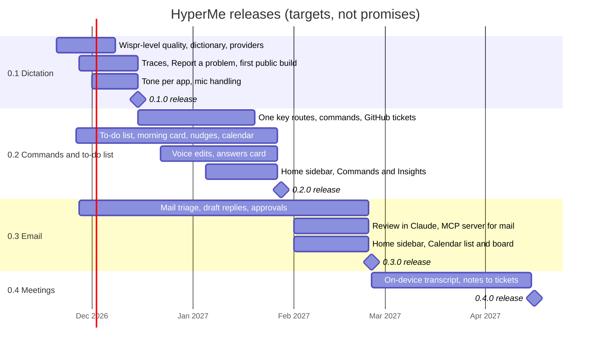

# HyperMe releases

How HyperMe is versioned, what each version brings, and how new work finds its version. The
phases, their scope and their gates are in [ROADMAP.md](ROADMAP.md); this page binds them to
version numbers and dates. Adopted by the owner on 27 November 2026.

## Numbering

HyperMe follows [Semantic Versioning](https://semver.org/) with a 0.x series while the product
grows, as most open-source apps do while they move fast:

- **0.N.0**: one minor version per phase. The phase's gate is the release check.
- **0.N.x**: a patch: fixes, and small additions that serve the version's goal (see Triage).
- **0.N.0-alpha.K**: a trial build, an unsigned draft release that only the owner installs.
- **1.0.0**: when the full copilot (0.1 to 0.4) is stable: config, stored data and the MCP surface
  stop breaking between versions. After 1.0, a new major means a breaking change, never just new
  features.

In conversation, "version 3" means 0.3.

## Versions

| Version | Phase | Features | Gate (from ROADMAP.md) | Target |
| --- | --- | --- | --- | --- |
| **0.1** | 1 and 2 | Dictation as good as Wispr Flow: hold or hands-free, cleanup levels, personal dictionary with Wispr Flow import, provider settings with any key or a local server, Home and History, local traces and **Report a problem**, in-app updates; tone per app (#219), microphone handling (#221). First public release | Edits per 100 characters at or below Wispr Flow's 11.6, internal names right, a week of daily use | mid-December 2026, under review after #219 and #221 are sized |
| **0.2** | 3 and 4 (tasks) | Voice commands and the to-do list: one key for dictation, questions and commands; "Hyper, remind me to …"; the task list with dependencies, the morning card and nudges, with calendar events; voice edits of selected text; answers in a card; GitHub tickets; Home sidebar: Commands, the commands run and what the agent did (#231); Insights, usage stats modeled on Wispr Flow's plus commands run and tasks done (#235, needs a spec first) | Commands and the to-do list every day for two weeks | late January 2027 |
| **0.3** | 4 (email) | Email: Google mail triage, draft-only replies, approvals from connector servers; **Review in Claude**: hand an email to the user's own Claude app, which drafts the reply and returns it through HyperMe's MCP server into the preview (proposed, [research](research/2026-11-28-email-drafts-through-claude.md)); research on cleaning text while the user speaks (#220); Home sidebar: Calendar with list and board views (#232) | A week of daily mail drafts | late February 2027 |
| **0.4** | 5 | Meetings: on-device live transcript, "Transcribe?" on a call, notes to proposed tickets, the Meetings page | Tickets from a real meeting accepted with few edits | April 2027 |
| **1.0** | | The four above, stable | A month with no breaking change | after 0.4 |
| Later | | Memory ("Hyper, remember …"), self-learning facts, the graph view and contexts; a Claude Code or Codex hand-off, local speech models and self-hosted providers on your own network (#261), Linux and Windows, Microsoft 365 | | |

Order set by the owner on 27 November 2026: dictation first, then voice commands and the to-do list, then email and meetings; memory, facts, the graph and contexts after 1.0.

Work that is merged before its version (much of 0.2 and 0.3 already is) stays off or hidden in the
releases before it, and ships with its version.

A bar names features. A big optimization (for example halving idle memory) gets its own bar;
routine tuning does not.

Each version is a GitHub milestone of the same name. Every issue carries the milestone it ships
in, or none for Later.

## Triage: where a new ask goes

When the owner asks for something new, the answer names its version, with a recommendation:

1. A fix for something released goes in the next patch.
2. It serves the current version's goal and does not move its date: this version, or its next
   patch if the version is out.
3. It belongs to a later phase: that version's milestone.
4. It fits no phase: Later, as an issue without a milestone.

When a choice moves a date or changes a version's goal, the owner decides.

## Research threads

A list ready to start, each tied to the version it feeds. "Open a research thread" takes the top
item unless the owner names another. Each one ends in `docs/research/<date>-<slug>.md` and a
recommendation.

| Research | Feeds | Source |
| --- | --- | --- |
| A second speech provider as fallback: latency and accuracy on the owner's samples | 0.1 | ROADMAP phase 2 |
| Tone per app: how others pick it, and what it costs in latency | 0.1 | ROADMAP phase 2 |
| Cleaning text while the user speaks (#220; current speed is good, so not needed for 0.1) | 0.3 | ROADMAP phase 2 |
| Quick notes: memory folder, task list or both | 0.2 (task side), Later (memory) | PRD Q-15 |
| How Hyper notices facts to remember | Later | PRD Q-16 |
| "Continue with ChatGPT" in onboarding: latency of answers | 0.2 | PRD Q-17 |
| HyperMe as an MCP server: what to expose, and how it is added to Claude desktop (needed by Review in Claude) | 0.3 at the latest | ROADMAP phase 3; [email drafts through Claude](research/2026-11-28-email-drafts-through-claude.md) |
| Microsoft 365 mail and calendar through MCP | Later | PRD Q-7 |
| Linux and Windows: overlay, hotkey, paste and keychain | Later | ROADMAP Later |
| Self-hosted providers: your own speech and model server on your network (#261) | Later, with local speech models | Owner, 28 November 2026 |

## Optimization and research passes

When work on a version starts (0.N), two threads open on everything already shipped (0.1 to
0.N-1):

- **Optimization pass**: idle memory and CPU, key-down and release latency against the budgets in
  CLAUDE.md; dependency count and size; the quality harness on the owner's samples; numbers to
  `docs/results/`. Anything found becomes a patch or an issue in a milestone.
- **Research refresh**: what changed in the field and in providers (models, prices, speed) since
  the version shipped, against `docs/FIELD.md` and the provider catalogue.

## Releasing

How a build is made, signed and published is in [RELEASING.md](RELEASING.md). Before each
release: bump `version` in the root `Cargo.toml`, move `[Unreleased]` in `CHANGELOG.md` under the
version, and close or move the milestone's open issues.
