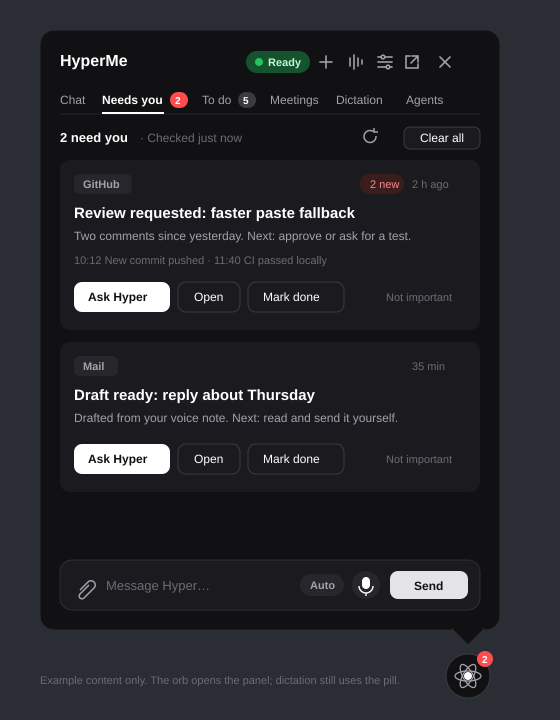
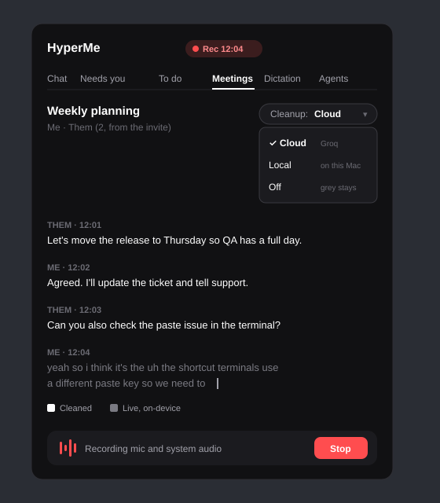

# HyperMe UX and UI

**Status:** draft for the owner, 26 November 2026. The choices marked **Proposed** wait for the
owner. Nothing here changes a phase gate in [ROADMAP.md](ROADMAP.md); it says what each phase
looks like and feels like. Mockups are in [ux/](ux/).

## The idea in one paragraph

HyperMe has one surface that grows. In Phase 1 it is only a **pill** that appears while you
dictate, plus a menu-bar icon and a settings window. From Phase 3 the pill gains a home: a small
**orb** in the corner that opens a compact dark **panel** with tabs. Each later phase adds one tab
to that panel, never a new window. The rule that holds it together: **the panel is where Hyper
talks back; the pill is where you talk to it.** Dictation never needs the panel.

## Principles

1. **Speed is the UI.** The pill shows recording within one frame of key-down (budget: under 50 ms
   to recording). No animation delays text; animations run beside the work, never before it.
2. **Never take focus.** The pill and the panel are non-activating panels (spec R-23). Typing
   goes on in the app you were in. Only an explicit click into the panel's composer takes focus.
3. **Quiet until needed.** Nothing on screen while idle in Phase 1. Later, the orb is small and
   still; only a count badge moves it.
4. **Say what happened, in a few words.** Every state has one short label ("Raw text",
   "Nothing heard"). Errors name the provider and point to the fix (R-21), never show a key.
5. **Preview before anything leaves the app.** Any action that creates, sends or posts shows a
   card and waits for Enter (`CLAUDE.md`). Email is draft-only.
6. **Light to run.** No front-end framework, no build step (design.md). The panel's web view is
   created when opened and dropped when closed, so idle memory stays under 100 MB.
7. **Dense but calm.** Near-black surfaces, white bold type for what matters, grey for the rest,
   one accent for state. Rounded cards, little chrome.

## Visual language

| Token | Value | Use |
| --- | --- | --- |
| Surface | `#111113` panel, `#1B1B1F` card, `#26262B` hover | Panel and pill backgrounds |
| Text | `#FFFFFF` primary, `#A1A1AA` secondary, `#6B6B73` live or muted | White is final, grey is provisional (this matters in meetings) |
| Accent | `#FF4D4F` recording, `#22C55E` ready or done, `#F59E0B` raw text or warning | State only, never decoration |
| Radius | 999 px pill, 14 px panel, 10 px card | |
| Type | System font (SF Pro on macOS), 13 px body, 15 px bold titles, 11 px meta | Native feel, no font download |
| Motion | 120 ms ease-out for show and hide; level meter at 30 fps | Respect "Reduce motion": no slide, only fade |

Colour is never the only signal: each state also has an icon and a word. Contrast of text on the
surfaces meets WCAG AA. Everything in the panel is reachable by keyboard: Tab between controls,
Enter to confirm a preview, Esc to close.

## Phase 1: dictation only

What the owner needs to drop Wispr Flow for a week. No orb and no panel yet.

### The flow

```
hold hotkey ──► pill appears, recording, live level ──► release ──► pill "working"
     │                                                                  │
     ├─ released in under 250 ms: nothing happens (R-5)                 ▼
     └─ Esc at any point: "Cancelled", nothing pasted (R-6)   text pasted at the cursor,
                                                              pill flashes "done" and hides
```

- **Hold to talk** is the only mode in Phase 1 (spec non-goals). Hands-free comes later (see
  decisions).
- A short **start sound** confirms the mic is live, as Wispr Flow does ("speak after the start
  sound", [Wispr docs](https://docs.wisprflow.ai/articles/6391241694-use-flow-hands-free)).
  Proposed: on by default, with a switch.
- **Esc** cancels at any time before paste. A key-down while working shows "Still working".

### The pill

A small capsule, bottom centre, about 120 by 32 pt, above full-screen apps and on every space.
It is hidden while idle.


| State | Look | Copy | How long |
| --- | --- | --- | --- |
| Recording | Red dot, live level bars | none | While held |
| Working | Three soft dots | none | Until text or deadline |
| Done | Green check | "Pasted" | 600 ms, then fades |
| Raw text | Amber dot | "Raw text" | 2 s; click shows why (cleanup slow or failed, R-20) |
| Nothing heard | Grey | "Nothing heard" | 1.5 s (R-14) |
| Notice | Grey lock | "Not available in password fields" | 2 s (R-17) |
| Error | Red outline | "Speechmatics key rejected · Settings" | 4 s or until clicked; click opens Settings (R-19 to R-21) |

The pill is draggable along the bottom edge and remembers its place, like Wispr Flow's bar
([Wispr docs](https://docs.wisprflow.ai/articles/5096240724-navigating-the-wispr-flow-app-desktop-ios-and-android)
mention moving and hiding it; the exact edge rules are not checked).

### Menu-bar icon

The app has no Dock icon and no main window (R-22). The menu-bar icon is a small waveform glyph
that turns red while recording. Its menu ([ux/menubar-onboarding.svg](ux/menubar-onboarding.svg)):

- Status line: "Ready", or the last error in a few words.
- **Paste last dictation** and **Copy last dictation** (R-18), the way out when paste fails.
  OpenWhispr and Wispr Flow both offer this.
- Settings…, Quit HyperMe.

The full menu plan by phase is under [Menus](#menus).

### Onboarding

Five short screens in one small window, each tested before "Next" lights up (R-27, AC-21):

1. **Welcome.** One line: "Hold a key, speak, and your words appear where you type."
2. **Microphone.** Ask, then show a live level so the user sees it works.
3. **Accessibility.** Needed to paste. A button opens the right System Settings page; the screen
   turns green by itself when the permission arrives.
4. **Keys.** One field per provider (Speechmatics, Groq), each with **Test**. The key goes
   straight to Rust and the keychain; the field never shows it again (R-25).
5. **Try it.** A text box in the window: "Hold Right Option and say anything." Shows the timing
   ("Pasted in 0.43 s") as the first proof of speed.

OpenWhispr's onboarding runs dictation first, then notes and meetings, then a live agent demo
([docs](https://docs.openwhispr.com/quickstart.md)). HyperMe keeps only the dictation part until
later phases add their own short "what's new" card.

### Settings window

Phase 1 shows the first seven sections of the settings plan below: General, Shortcuts, Providers,
Privacy, Advanced, About, and a Setup check at the top. Mockup: [ux/settings.svg](ux/settings.svg).

## Settings, tabs and menus

HyperMe needs more setup than a dictation app: two or more providers with keys, then
connectors, scheduled jobs and meetings. The owner's bar is a UI as slim as Wispr Flow's, which
the owner likes and uses every day. So the setup has to be well organised and mostly out of sight.

### How the top tools organise it

From their public docs, read on 26 November 2026.

| Tool | How it is organised | Take or avoid |
| --- | --- | --- |
| Wispr Flow | A main window (the "Hub") whose sidebar holds what you use and personalise: Home, Dictionary, Snippets, Style, Notes and more. Settings sits at the bottom of that sidebar with few sections: General (shortcuts, microphone, languages), System (launch at login, Flow Bar, notifications, Dock icon) and Account ([docs](https://docs.wisprflow.ai/articles/5096240724-navigating-the-wispr-flow-app-desktop-ios-and-android)) | **Take:** personalisation is not a setting. Dictionary and style live where you use them, and Settings stays short |
| Superwhisper | Settings has Configuration, Modes and Sound. Advanced settings stay hidden until you switch them on at the bottom of Configuration. You can open Settings from the menu bar, by right-clicking the recording window, with ⌘, or through a deep link (`superwhisper://settings`) ([docs](https://superwhisper.com/docs/get-started/settings.md), [advanced](https://superwhisper.com/docs/get-started/settings-advanced)) | **Take:** hide Advanced by default; many ways in; deep links to a page; "pause media while recording" |
| Raycast | Settings on ⌘, with General for everyday options and Advanced for power users ([manual](https://manual.raycast.com/settings)) | **Take:** an everyday-versus-advanced split |
| OpenWhispr | Nine sections. The speech and model sections each have per-feature tabs, and every tab keeps its own engine ([docs](https://docs.openwhispr.com/help/customise/settings-reference.md)) | **Avoid:** "switch to local" turns into many settings, and people look in the right section but on the wrong tab |
| macOS System Settings | A sidebar with search at the top | **Take:** search across every setting |

### Where each thing lives

Every setting has exactly one home, chosen by how often it is used:

| Place | What goes there | Examples |
| --- | --- | --- |
| Pill and orb | Nothing to configure. Right-click opens the same menu as the menu-bar icon | |
| Menu-bar menu | Things you do several times a day, at most 8 items | Paste last dictation, start a meeting, pause notifications |
| Panel tabs (Phase 3+) | Work, and the personalisation that comes from using it | Add a word to the dictionary from a dictation, mark a card "Not important" |
| Settings window | Setup you do once, and preferences you rarely change | Keys, providers, shortcuts, connectors |
| `config.toml` | Everything, for people who prefer a file. Settings writes to it, and Advanced has "Open config file" | Endpoints, thresholds, model names (R-26) |

### The settings plan

One window with a search field at the top and a sidebar in two groups. A section shows up only
once its feature exists: no "coming soon" pages.

| Group | Section | Holds | From |
| --- | --- | --- | --- |
| | **Setup check** | One line per requirement with a green tick or a fix button: microphone, accessibility, each provider key, each connector. The first page until everything is green, and the place every error links to | 1 |
| Everyday | **General** | Launch at login; pill position and whether it shows while idle; sounds (start and stop: soft, off); pause media while dictating; theme follows the system | 1 |
| | **Shortcuts** | Dictation (hold), hands-free, cancel (Esc), paste last dictation, open panel; later command and meeting. One list, with conflicts flagged | 1 |
| | **Dictionary** | Words and sound-alike replacements, with import and export. Also reachable from the panel | 2 |
| | **Style** | Cleanup level (none, light, medium) and a style per kind of app: personal chat, work chat, email, other. Same groups as Wispr Flow | 2 |
| Setup | **Providers** | One page for every model service. Each row shows provider, model, key status and a Test button, and says which features use it ("Used by: dictation, meetings"). Choosing what each feature uses is a short table on the same page, never a tab per feature | 1 |
| | **Connectors** | MCP servers (GitHub first). Each has its tools, a switch per tool, and "ask before" on for anything that writes (`CLAUDE.md`) | 3 |
| | **Automations** | Scheduled jobs: a prompt, a schedule and a tool allowlist each (SPEC section 4), with last run and next run | 4 |
| | **Meetings** | Calendar, capture (mic and system audio), cleanup **Cloud, Local or Off**, what happens after the meeting | 5 |
| | **Privacy** | In plain words, what leaves the Mac and to whom; history kept or not and for how long; timing log; "no audio on disk" | 1 |
| | **Advanced** | Hidden until "Show advanced" at the bottom of General: deadlines, thresholds, endpoints, log files, open config file, reset | 1 |
| | **About** | Version, licence, updates (Phase 2), links | 1 |

### Rules that keep it slim

1. **Two keys to start.** With the defaults, a new user only enters a Speechmatics key and a Groq
   key. Everything else has a good default.
2. **Saves as you go**, as macOS settings do. No Save button. Each section has a quiet "Reset
   section".
3. **A test next to every secret.** A key field shows its state ("Works, 151 ms") and never the
   key again (R-25).
4. **Each page fits the window** at its default size. A longer page means it should be split, or
   part of it belongs in Advanced.
5. **Errors link to their row.** "Speechmatics key rejected · Settings" opens Providers with that
   row highlighted. The app supports `hyperme://settings/<section>` links, like Superwhisper.
6. **Search finds every setting**, including Advanced ones, by its name and by common words
   ("hotkey" finds Shortcuts).
7. **One name per thing.** Settings, menus and pill copy use the same words: "dictation", "pill",
   "panel", "Hyper".

### Menus

The **menu-bar menu** grows by phase but stays at 8 items or fewer:

| Item | From |
| --- | --- |
| Status: "Ready", or the open problem with a link to Setup check | 1 |
| Paste last dictation ⌃⌥V · Copy last dictation | 1 |
| Open HyperMe (the panel) | 3 |
| Start meeting notes / Stop | 5 |
| Pause Hyper for 1 hour (no nudges, no automations; dictation still works) | 4 |
| Settings… ⌘, | 1 |
| Quit HyperMe ⌘Q | 1 |

Right-clicking the pill or the orb shows the same menu. Timing log moves to Privacy, so the menu
holds actions only.

### Panel tabs

- A tab appears only once its feature is set up. A fresh install that has connected GitHub but
  not mail sees Chat and Needs you, not To do.
- Never more than six tabs. If a seventh ever comes up, two of them merge.
- Badges only where they carry meaning: red on Needs you, grey on To do, nothing anywhere else.
- The panel's sliders icon opens the Settings window at the section for the current tab (from
  Meetings, it opens Meetings). There are no settings inside the panel, so the panel stays slim.

## Phase 2: quality and first release


Still no panel required. What changes on screen:

- **Dictionary** and **Style** sections in Settings ([the settings plan](#the-settings-plan)).
- **Cleanup level** and **style per app**, shown as the app's name on the pill while working, so
  the user sees which style ran.
- **Hands-free**, if the owner adopts it here: double-tap the hotkey to lock recording, tap again
  to stop, with a stop button on the pill (Wispr Flow's pattern).
- **History**, if adopted: a list of recent dictations to copy or re-paste. It is the first
  reason for a panel, so it becomes the panel's **Dictation** tab (see decisions).

## Phase 3 onward: the orb and the panel



### The orb

A 40 pt circle, bottom right, with a slow, faint animation only while Hyper is working on
something. A red badge shows how many items need the user. Click opens the panel; drag moves it;
right-click offers the menu-bar menu. Dictation still uses the pill, not the orb.

### The panel

A dark panel about 420 by 560 pt, anchored above the orb with a small tail pointing at it.

**Header:** "HyperMe" on the left. On the right: a status pill ("Ready", green; "Listening", red;
"Offline", grey), then icons for new chat, voice, settings, pop out to a window, and close.

**Tabs,** added one per phase:

| Tab | Phase | Shows |
| --- | --- | --- |
| Chat | 3 | Answers to spoken questions and action previews. Each message has Hyper's name, time, a bold one-line headline ("Ticked off 2 reviews"), bullets, and a dismiss X. A smaller line under it says what Hyper learned, and done items say where to get them back ("Under Done this week") |
| Needs you | 4 | Items waiting for a decision, with a red count |
| To do | 4 | Daily tasks and scheduled jobs, with a grey count |
| Meetings | 5 | Week calendar and the live note-taker |
| Dictation | 2 or 3 | History, if adopted: copy, re-paste, fix a word |
| Agents | 5 | Coding-agent tasks started by voice (Claude Code, Devin), with state and result |

**Composer,** at the bottom of every tab: attach, "Message Hyper…", a language chip (Auto, ES,
EN), a mic button and Send. The mic button and the hotkey do the same thing.

### Smart routing (Phase 3)

One key for everything you say (ROADMAP Phase 3). The pill shows where the words went before
anything happens: "Dictation" (pasted), "Question" (answer appears in the panel's Chat tab and as
a short line on the pill), or "Action" (a preview card opens in the panel and waits for Enter).
Saying "Hyper, …" at the start routes to a command, as OpenWhispr's agent name does; OpenWhispr
notes this is the feature that surprises people most, because it is on by default
([docs](https://docs.openwhispr.com/help/agent/voice-modes.md)). Proposed: the pill always shows
the route, and a dictation that became a command can be undone with one key back to plain text.

### Cards (Needs you, Phase 4)

Each card: a source chip (GitHub, Mail, Calendar), a bold title, a one-line summary ending in
"Next: …", optional sub-rows with times and "N new" or "2 h ago" badges, then buttons: a filled
**Ask Hyper**, outlined **Open** and **Mark done**, and a quiet "Not important" link on the right.
The tab header shows the count, "Checked just now", a refresh icon and "Clear all".

"Not important" is a signal for later learning (memory is part of the vision, not of a first
version); in Phase 4 it only hides the item.

## Meetings (Phase 5)



Built on the on-device design adopted on
26 November 2026 (ROADMAP, "Meetings on device").

- **Week view:** a header with the count ("8 today"), Monday to Friday, today circled, events as dark blocks, a search icon and a
  List or Week toggle. Each upcoming event offers **Record**.
- **Live view:** the transcript scrolls as people speak. **Live words are grey** (Apple's
  on-device recognizer); **cleaned sentences turn white** as each batch comes back from cleanup.
  Lines are labelled **Me** (microphone) and **Them** (system audio), named from the invite.
- **Cleanup setting** as a chip in the header with three choices: **Cloud** (Groq, default),
  **Local** (any OpenAI-compatible server), **Off** (grey text stays grey; nothing leaves the
  Mac). The chip says what leaves the Mac in a tooltip.
- **Always visible while recording** (safety rule): a red dot on the orb and the menu-bar icon,
  with a timer, for as long as capture runs.
- **After the meeting:** notes, action points and **proposed tickets** with owner and the exact
  quote. Proposals stay pending until the user applies them (Anarlog's pattern, FIELD.md); each
  "Create" opens a preview and waits for Enter.

OpenWhispr's meeting note opens on "Your notes" with the transcript on a second tab, and shows a
"Waiting for microphone" state instead of failing quietly
([docs](https://docs.openwhispr.com/help/meetings/record-a-meeting.md)). Worth copying: the
explicit waiting state and typing notes beside the call.

## What we take from Wispr Flow and OpenWhispr

From their public docs, read on 26 November 2026. The owner uses Wispr Flow daily and found
an earlier OpenWhispr slow and dislikes its UI (FIELD.md).

| Pattern | Wispr Flow | OpenWhispr | HyperMe |
| --- | --- | --- | --- |
| Default hotkey | Fn hold to talk; Fn + Space hands-free | Globe (Fn), via a bundled listener; tap by default, hold optional | Right Option hold (spec, proposed); Fn offered |
| Hands-free | Separate shortcut or double-tap; second press within 0.5 s cancels | Tap mode is the default | Phase 2, double-tap (proposed) |
| On-screen bar | Flow Bar shown by default; click to start, stop button | Floating panel, bottom right by default, auto-hide off | Pill only while dictating in Phase 1; orb from Phase 3 |
| Paste failure | "Select a textbox first", Paste last transcript | Pasted without cleanup is announced | Raw text label, Paste last dictation |
| Cleanup off or failed | Not documented here | "Pasted without AI cleanup" note; cleanup has its own model | Raw text label (R-20) |
| Commands | Command Mode on its own shortcut, off by default | Four hotkeys, plus the agent's name in dictation | One key, routed, with the route shown (Phase 3) |
| Settings | Shortcuts, mic, languages, Flow Bar visibility | Nine sections; engines per feature on tabs | Setup check first; one Providers page with a feature table; Advanced hidden ([the settings plan](#the-settings-plan)) |

Sources: [Wispr hands-free](https://docs.wisprflow.ai/articles/6391241694-use-flow-hands-free),
[Wispr Command Mode](https://docs.wisprflow.ai/articles/4816967992-how-to-use-command-mode),
[Wispr app tour](https://docs.wisprflow.ai/articles/5096240724-navigating-the-wispr-flow-app-desktop-ios-and-android),
[OpenWhispr hotkeys](https://docs.openwhispr.com/help/dictation/hotkeys.md),
[OpenWhispr hold or tap](https://docs.openwhispr.com/help/dictation/hold-or-tap.md),
[OpenWhispr background and panel](https://docs.openwhispr.com/platform/running-in-the-background.md),
[OpenWhispr cleanup](https://docs.openwhispr.com/help/dictation/cleanup.md). Wispr Flow's Fn
default for hold to talk is from common knowledge of the app, not re-checked here.

## Decisions for the owner

| # | Question | Proposed |
| --- | --- | --- |
| U-1 | When does the always-visible orb appear? | Phase 3, when the panel has something to show. Phase 1 shows the pill only while dictating |
| U-2 | Default dictation hotkey | Right Option hold, as in the Phase 1 spec, with Fn offered in onboarding |
| U-3 | Hands-free (double-tap to lock) | Phase 2, not Phase 1 |
| U-4 | Dictation history on disk | Opt-in, off by default, kept 7 days; it becomes the panel's Dictation tab |
| U-5 | Start and stop sounds | On by default, soft, with a switch |

## Not decided here

Look and copy for email (Phase 4) and coding agents (Phase 5) beyond their tab; a light theme;
Linux and Windows placement of the orb and pill.
