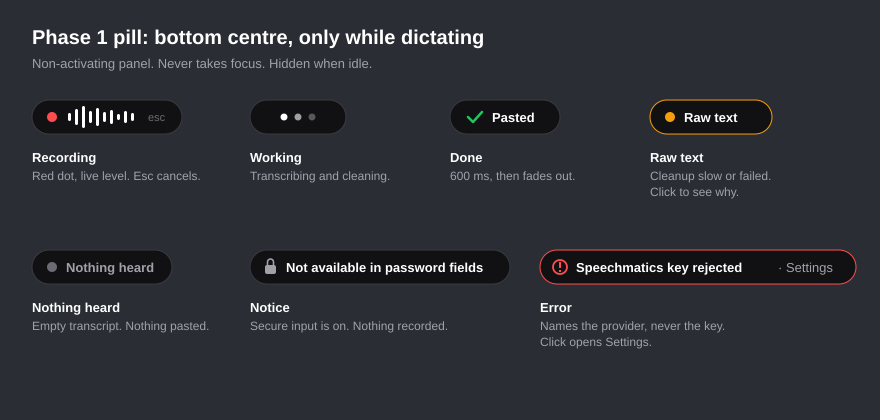
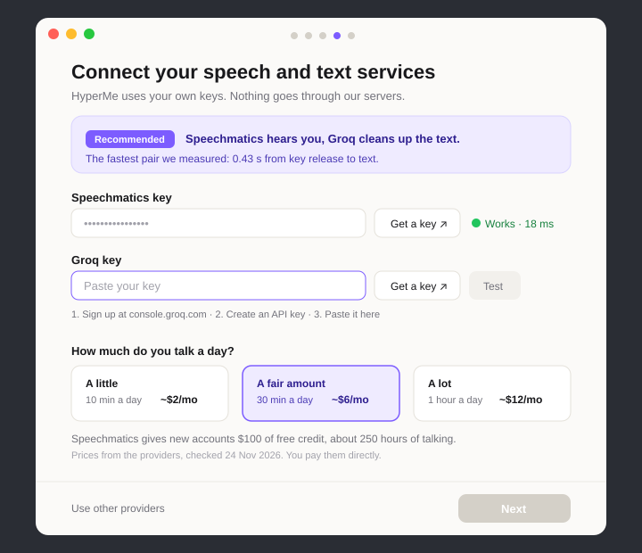
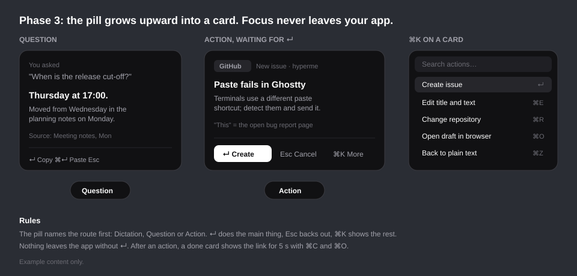
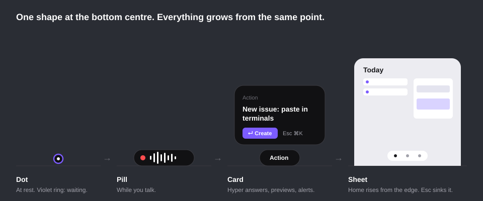
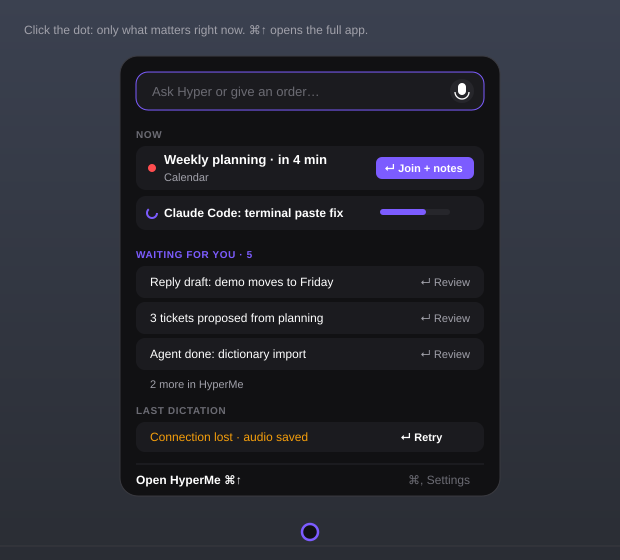
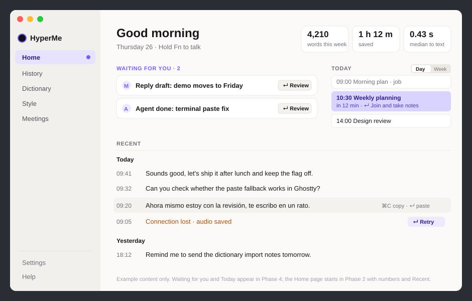
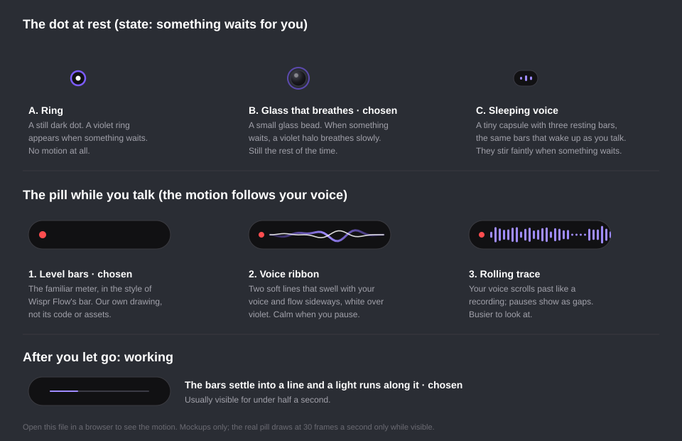

# HyperMe UX and UI

**Status:** draft, 26 November 2026. The owner decided U-1 to U-12 the same day. Nothing here changes a phase gate in [ROADMAP.md](ROADMAP.md); it says what each phase
looks like and feels like. Mockups are in [ux/](ux/).

## The idea in one paragraph

HyperMe is voice first, so **the pill is the product**. In Phase 1 it shows only while you
dictate, with a menu-bar icon and a settings window around it. In Phase 3 the pill also answers:
it grows upward into a card with the answer or a preview that waits for ↵. Work that outlives a
card lives in **Home**, one plain window with a few views taken from the roadmap: History, Today
and Meetings. The rule that holds it together: **quick things happen at the pill, lasting things
in Home, a window in the style of Wispr Flow's.** Dictation never needs Home. Each surface comes from a job in the roadmap, and the
patterns are borrowed from the best Mac apps, not from any single app.

## Principles

1. **Speed is the UI.** The pill shows recording within one frame of key-down (budget: under 50 ms
   to recording). No animation delays text; animations run beside the work, never before it.
2. **Never take focus.** The pill and its cards are non-activating panels (spec R-23). Typing
   goes on in the app you were in. Only Home, a normal window, takes focus, and only when you
   open it.
3. **Quiet until needed.** Nothing on screen while idle in Phase 1. Later, a small dot on the
   bottom edge, with a ring only when something waits.
4. **Say what happened, in a few words.** Every state has one short label ("Raw text",
   "Nothing heard"). Errors name the provider and point to the fix (R-21), never show a key.
5. **Preview before anything leaves the app.** Any action that creates, sends or posts shows a
   card and waits for Enter (`CLAUDE.md`). Email is draft-only.
6. **Light to run.** No front-end framework, no build step (design.md). Home's web view is
   created when opened and dropped when closed, so idle memory stays under 100 MB.
7. **Calm, and recognisably HyperMe.** The pill and cards are dark capsules, as in Wispr Flow,
   which the owner likes. Home is a calm window with a sidebar, in Wispr Flow's style, in the system's light or dark mode. One
   signature colour, Hyper violet, marks focus, the main key and things waiting for you.
   Actions show as keycaps ("↵ Review"), not as rows of buttons.
8. **Keyboard everywhere.** ↵ does the main thing, Esc backs out, ⌘K shows everything else.

## Visual language

| Token | Value | Use |
| --- | --- | --- |
| Surface | `#111113` pill and card, `#1B1B1F` raised, `#26262B` hover | Pill and cards (Home uses the system's colours) |
| Text | `#FFFFFF` primary, `#A1A1AA` secondary, `#6B6B73` live or muted | White is final, grey is provisional (this matters in meetings) |
| Signature | `#7C5CFF` Hyper violet | Focus, the main key on a card, the waiting ring on the dot |
| State | `#FF4D4F` recording, `#22C55E` done, `#F59E0B` raw text or warning | State only, never decoration |
| Radius | 999 px dot and pill, 18 px card, 12 px window | |
| Type | SF Pro Rounded for titles and the pill, SF Pro for body; 13 px body, 15 px titles, 11 px meta | Native, no font download; the rounded titles match the shape |
| Motion | One 180 ms spring from the dot's centre for every size change; level meter at 30 fps | With "Reduce motion", cross-fade only |

Colour is never the only signal: each state also has an icon and a word. Contrast of text on the
surfaces meets WCAG AA. Everything in the cards and Home is reachable by keyboard: Tab between controls,
Enter to confirm a preview, Esc to close.

## Phase 1: dictation only

What the owner needs to drop Wispr Flow for a week. No cards and no Home yet.

### The flow

```
hold hotkey ──► pill appears, recording, live level ──► release ──► pill "working"
     │                                                                  │
     ├─ released in under 250 ms: nothing happens (R-5)                 ▼
     └─ Esc at any point: "Cancelled", nothing pasted (R-6)   text pasted at the cursor,
                                                              pill flashes "done" and hides
```

- **Hold to talk** is the only mode in Phase 1. Hands-free comes in Phase 2 (owner, U-3).
- A short **start sound** confirms the mic is live, as Wispr Flow does ("speak after the start
  sound", [Wispr docs](https://docs.wisprflow.ai/articles/6391241694-use-flow-hands-free)).
  Soft start and stop sounds, on by default, with a switch (owner, U-5; spec R-32).
- **Esc** cancels at any time before paste. A key-down while working shows "Still working".

### The pill

A small capsule, bottom centre, about 120 by 32 pt, above full-screen apps and on every space.
It is hidden while idle.



| State | Look | Copy | How long |
| --- | --- | --- | --- |
| Recording | Red dot, live level bars | none | While held |
| Working | The bars settle into a thin line and a violet light runs along it (U-15) | none | Until text or deadline |
| Done | Green check | "Pasted" | 600 ms, then fades |
| Raw text | Amber dot | "Raw text" | 2 s; click shows why (cleanup slow or failed, R-20) |
| Nothing heard | Grey | "Nothing heard" | 1.5 s (R-14) |
| Notice | Grey lock | "Not available in password fields" | 2 s (R-17) |
| Error | Red outline | "Speechmatics key rejected · Settings" | 4 s or until clicked; click opens Settings (R-19 to R-21) |
| Saved, retry | Red outline, retry arrow | "Connection lost · Retry" | Until clicked or dismissed. The audio is kept, so Retry transcribes it again (R-31) |

The pill is draggable along the bottom edge and remembers its place, like Wispr Flow's bar
([Wispr docs](https://docs.wisprflow.ai/articles/5096240724-navigating-the-wispr-flow-app-desktop-ios-and-android)
mention moving and hiding it; the exact edge rules are not checked).

### Menu-bar icon

The app has no Dock icon and no main window (R-22). The menu-bar icon is the logo's speed pill
([brand/README.md](brand/README.md)), and it turns red while recording. Its menu ([ux/menubar-onboarding.svg](ux/menubar-onboarding.svg)):

- Status line: "Ready", or the last error in a few words.
- **Paste last dictation** and **Copy last dictation** (R-18), the way out when paste fails.
  OpenWhispr and Wispr Flow both offer this.
- Settings…, Quit HyperMe.

The full menu plan by phase is under [Menus](#menus).

### Onboarding

Five short screens in one small window, each tested before "Next" lights up (R-27, AC-21):

1. **Welcome.** One line: "Hold a key, speak, and your words appear where you type."
2. **Microphone.** Ask, then show a live level so the user sees it works.
3. **Accessibility and Input Monitoring.** Accessibility is needed to paste; Input Monitoring is
   needed to see the Fn key, so the hotkey cannot work without it. One row each, each with a
   button that opens the right System Settings page; each row turns green by itself when its
   permission arrives.
4. **Keys for the recommended setup.** See [Models and keys in onboarding](#models-and-keys-in-onboarding)
   below: two keys, a cost estimate, and one quiet link to other providers.
5. **Try it.** A text box in the window: "Hold Fn and say anything." Shows the timing
   ("Pasted in 0.43 s") as the first proof of speed.

OpenWhispr's onboarding runs dictation first, then notes and meetings, then a live agent demo
([docs](https://docs.openwhispr.com/quickstart.md)). HyperMe keeps only the dictation part until
later phases add their own short "what's new" card.

### Models and keys in onboarding



The owner's rule (26 November 2026): the wizard guides people to our recommended models and asks
only for those keys. Choosing any provider and model per role stays in Settings → Advanced.
Downloadable local models come later.

**The keys step** has three parts, top to bottom:

1. **The recommended setup, already chosen.** One card: "Speechmatics hears you, Groq cleans up
   the text. The fastest pair we measured: 0.43 s from key release to text." No model names on
   this screen; they are in Advanced.
2. **Two key fields**, one per provider. Each has a **Get a key** button that opens the
   provider's sign-up page in the browser with three short steps beside the field (sign up, create
   a key, paste it here), and a **Test** that turns green with the round-trip time. The key goes
   straight to Rust and the keychain; the field never shows it again (R-25). Next lights up when
   both are green.
3. **What it will cost you.** One question: "How much do you talk a day?" with three choices,
   and the monthly cost under each:

| Choice | Talking time | Speech (Speechmatics) | Cleanup (Groq) | Shown as |
| --- | --- | --- | --- | --- |
| A little | 10 min a day, about 1 h a week | about USD 2 | about USD 0.05 | "About $2 a month" |
| A fair amount | 30 min a day, about 3.5 h a week | about USD 6 | about USD 0.15 | "About $6 a month" |
| A lot | 1 h a day, about 7 h a week | about USD 12 | about USD 0.30 | "About $12 a month" |

   Under the choices: "Speechmatics gives new accounts USD 100 of free credit, about 250 hours of
   talking." Talking time is time actually speaking, not time the app is open; a month counts as 30 days. Prices are
   Speechmatics Melia 1 at USD 0.40 an hour and Groq `gpt-oss-20b` at USD 0.075 / 0.30 per
   million tokens, from the research of 24 November 2026
   ([research](research/2026-11-24/01-dictation.md), section 3). They live in the config file
   next to the model names, and must be checked against the providers' pages before each release.
   Meetings add little: speech runs on the Mac, and Groq cleanup costs about USD 0.20 to 0.35 a
   month for 8 hours of meetings a week ([ROADMAP.md](ROADMAP.md)).

**The way out** is one quiet link under the keys: "Use other providers". It opens Settings →
Providers with Advanced showing, and the wizard waits; when every role has a provider whose test
passes, the wizard's Next lights up. Most people never see it.

**Settings → Providers** shows the recommended pair by default, as the wizard left it. "Show
advanced" opens the full choice, one row per role, each with a provider and a model:

| Role | From | Providers offered |
| --- | --- | --- |
| Dictation speech | 1 | Speechmatics (recommended), OpenAI first among the others, then Deepgram, AssemblyAI, ElevenLabs, Soniox |
| Dictation cleanup | 1 | Groq (recommended), OpenAI first among the others, then Anthropic, Google Gemini, OpenRouter, any OpenAI-compatible endpoint |
| Answers and actions | 3 | Same list as cleanup; a larger model by default |
| Meeting cleanup | 5 | Cloud (Groq), Local (an OpenAI-compatible server on the Mac) or Off; meeting speech always runs on the Mac |
| Local models to download | Later | Not in version 1 |

This list follows the range OpenWhispr offers with your own keys (OpenAI, Groq, Deepgram,
AssemblyAI, ElevenLabs, OpenRouter, Anthropic, Gemini, local and self-hosted endpoints)
([docs](https://docs.openwhispr.com/guides/cloud-vs-local.md)), but not its layout: OpenWhispr
spreads the choice over per-feature tabs, while HyperMe keeps one table of roles on one page.
Each provider needs only one key, shared by every role that uses it. Choosing a provider shows
its own cost line, worked out the same way as in the wizard.

### Settings window

Phase 1 shows the first seven sections of the settings plan below: General, Shortcuts, Providers,
Privacy, Advanced, About, and a Setup check at the top. Mockup: [ux/settings.svg](ux/settings.svg).

## Settings, Home and menus

HyperMe needs more setup than a dictation app: two or more providers with keys, then
connectors, scheduled jobs and meetings. The owner's bar is a UI as slim as Wispr Flow's, which
the owner likes and uses every day. So the setup has to be well organised and mostly out of sight.

### How the top tools organise it

From their public docs, read on 26 November 2026.

| Tool | How it is organised | Take or avoid |
| --- | --- | --- |
| Wispr Flow | A main window (the "Hub") whose sidebar holds what you use and personalise: Home, Dictionary, Snippets, Style, Notes and more. Settings sits at the bottom of that sidebar with few sections: General (shortcuts, microphone, languages), System (launch at login, Flow Bar, notifications, Dock icon) and Account ([docs](https://docs.wisprflow.ai/articles/5096240724-navigating-the-wispr-flow-app-desktop-ios-and-android)) | **Take:** personalisation is not a setting. Dictionary and style live where you use them, and Settings stays short |
| Superwhisper | Settings has Configuration, Modes and Sound. Advanced settings stay hidden until you switch them on at the bottom of Configuration. You can open Settings from the menu bar, by right-clicking the recording window, with ⌘, or through a deep link (`superwhisper://settings`) ([docs](https://superwhisper.com/docs/get-started/settings.md), [advanced](https://superwhisper.com/docs/get-started/settings-advanced)) | **Take:** hide Advanced by default; many ways in; deep links to a page; "pause media while recording" |
| Raycast | Settings on ⌘, with General for everyday options and Advanced for power users ([manual](https://manual.raycast.com/settings)) | **Take:** an everyday-versus-advanced split |
| OpenWhispr | Nine sections. The speech and model sections each have per-feature tabs, and every tab keeps its own engine ([docs](https://docs.openwhispr.com/help/customise/settings-reference.md)) | **Avoid:** "switch to local" turns into many settings, and people look in the right section but on the wrong tab |
| macOS System Settings | A sidebar with search at the top | **Take:** search across every setting |

### Where each thing lives

Every setting has exactly one home, chosen by how often it is used:

| Place | What goes there | Examples |
| --- | --- | --- |
| Pill and its cards | Nothing to configure. Right-click opens the same menu as the menu-bar icon | |
| Menu-bar menu | Things you do several times a day, at most 8 items | Paste last dictation, start a meeting, pause notifications |
| Home (Phase 2+) | Work, and the personalisation that comes from using it | Fix a word into the dictionary from History, dismiss a proposal in Today |
| Settings window | Setup you do once, and preferences you rarely change | Keys, providers, shortcuts, connectors |
| `config.toml` | Everything, for people who prefer a file. Settings writes to it, and Advanced has "Open config file" | Endpoints, thresholds, model names (R-26) |

### The settings plan

One window with a search field at the top and a sidebar in two groups. A section shows up only
once its feature exists: no "coming soon" pages.

| Group | Section | Holds | From |
| --- | --- | --- | --- |
| | **Setup check** | One line per requirement with a green tick or a fix button: microphone, accessibility, input monitoring, each provider key, each connector. The first page until everything is green, and the place every error links to | 1 |
| Everyday | **General** | Launch at login; pill position and whether it shows while idle; sounds (start and stop: soft, off); pause media while dictating; theme follows the system | 1 |
| | **Shortcuts** | Dictation (hold), hands-free, cancel (Esc), paste last dictation, open Home; later command and meeting. One list, with conflicts flagged | 1 |
| Setup | **Providers** | The recommended pair by default: each row shows provider, key status, a Test button and which features use it ("Used by: dictation"). "Show advanced" opens the table of roles, one provider and model each ([Models and keys](#models-and-keys-in-onboarding)), never a tab per feature | 1 |
| | **Connectors** | MCP servers (GitHub first). Each has its tools, a switch per tool, and "ask before" on for anything that writes (`CLAUDE.md`) | 3 |
| | **Automations** | Scheduled jobs: a prompt, a schedule and a tool allowlist each (SPEC section 4), with last run and next run | 4 |
| | **Meetings** | Calendar, capture (mic and system audio), cleanup **Cloud, Local or Off**, what happens after the meeting | 5 |
| | **Privacy** | In plain words, what leaves the Mac and to whom; dictation history (on by default; 30 days or unlimited; size limit, default 1 GB); timing log; audio never leaves the Mac except to the speech provider | 1 |
| | **Advanced** | Hidden until "Show advanced" at the bottom of General: deadlines, thresholds, endpoints, log files, open config file, reset | 1 |
| | **About** | Version, licence, updates (Phase 2), links | 1 |

### Rules that keep it slim

1. **Two keys to start.** With the defaults, a new user only enters a Speechmatics key and a Groq
   key. Everything else has a good default.
2. **Saves as you go**, as macOS settings do. No Save button. Each section has a quiet "Reset
   section".
3. **A test next to every secret.** A key field shows its state ("Works, 151 ms") and never the
   key again (R-25).
4. **Each page fits the window** at its default size. A longer page means it should be split, or
   part of it belongs in Advanced.
5. **Errors link to their row.** "Speechmatics key rejected · Settings" opens Providers with that
   row highlighted. The app supports `hyperme://settings/<section>` links, like Superwhisper.
6. **Search finds every setting**, including Advanced ones, by its name and by common words
   ("hotkey" finds Shortcuts).
7. **One name per thing.** Settings, menus and pill copy use the same words: "dictation", "pill",
   "card", "Home", "Hyper".

### Menus

What other good Mac apps teach about menus, and what HyperMe takes:

| App | Pattern | In HyperMe |
| --- | --- | --- |
| Raycast | ↵ runs the main action, ⌘↵ the second, ⌘K lists every action for the selected item ([manual](https://manual.raycast.com/action-panel)) | The same keys on every pill card and Home item |
| Superhuman | Cmd+K finds and runs anything, and shows each action's shortcut beside it, so you learn the key and stop opening the palette ([help](https://help.superhuman.com/article/478-superhuman-command)) | Home's command bar shows shortcuts beside commands |
| Linear | The command menu runs any action or opens any page by name; ? lists every shortcut; two-key jumps such as G then I ([guide](https://linear.app/enablement/guides/navigating-linear)) | ⌘K in Home, ? for shortcuts, G then H, Y, D or M for Home, History, Dictionary, Meetings |
| CleanShot X | A small overlay after each capture with one-key actions (copy, save, close, upload) ([iMore](https://www.imore.com/cleanshot-x-gains-new-keyboard-shortcuts-quick-access-overlay-more)) | The done card after an action: ⌘C copies the link, ⌘O opens it |
| Things 3 | A global shortcut opens Quick Entry; with Autofill it takes the link of what you are looking at ([support](https://culturedcode.com/things/support/articles/2249437/)) | "For this" in commands means the thing in front of you, shown on the card |
| Notion Calendar | Upcoming events in the menu bar and a system-wide shortcut to join a meeting ([help](https://www.notion.com/help/notion-calendar-settings)) | Next meeting in the menu header; ↵ on a nudge joins it and starts notes |
| Superwhisper | Settings open from the menu bar, a right-click on the recording window, ⌘, or a deep link ([docs](https://superwhisper.com/docs/get-started/settings.md)) | The same ways in, with `hyperme://` links |

The **menu-bar menu** grows by phase but stays at 8 rows or fewer:

| Row | From |
| --- | --- |
| Status: "Ready", or the open problem with a link to Setup check. From Phase 4 it also shows the next meeting: "Next: Weekly planning, 10:30" | 1 |
| **Recent**: the last three dictations, one line each. Click copies; a failed one shows **Retry** | 1 |
| Paste last dictation ⌃⌥V | 1 |
| Open HyperMe (the Home window) ⌥⌘Space | 2 |
| Start meeting notes / Stop | 5 |
| Pause Hyper for 1 hour (no nudges, no jobs; dictation still works) | 4 |
| Settings… ⌘, | 1 |
| Quit HyperMe ⌘Q | 1 |

Right-clicking the pill shows the same menu. The timing log is in Privacy, so the menu holds only
actions.

### Home sections

- A section or block appears only once its feature exists: Home, History, Dictionary and Style
  in Phase 2, the Waiting and Today blocks in Phase 4, Meetings in Phase 5. Nothing empty waits
  for a later phase.
- Five sections at most. A sixth only if the roadmap adds a job that none of them fits.
- One mark of attention: a violet dot on Home in the sidebar when something waits for a yes. No
  counts.
- ⌘, opens Settings at the section closest to where you are.

## Phase 2: quality and first release


What changes on screen:

- **Dictionary** and **Style** sections in Home ([Home](#home)).
- **Cleanup level** and **style per app**, shown as the app's name on the pill while working, so
  the user sees which style ran.
- **Hands-free** (owner, U-3): double-tap the hotkey to lock recording, tap again
  to stop, with a stop button on the pill (Wispr Flow's pattern).
- **Home → History:** dictation history is on from Phase 1 (U-4), so Phase 2 gives it a place to
  search, copy, re-paste, retry and fix words. Phase 1 has only Recent in the menu.

## Phase 3 onward: the pill grows, and Home

Every surface here comes from a job in [ROADMAP.md](ROADMAP.md), not from another app's layout:

| Roadmap job | Phase | Where it happens |
| --- | --- | --- |
| Dictate anywhere, and never lose a dictation | 1 | The pill; Recent and Retry in the menu (spec R-18, R-31) |
| Find and fix what I said | 2 | **Home → History** |
| "Speak, preview card, Enter" in under a second | 3 | A **card that grows out of the pill** |
| Short questions answered in the pill | 3 | The same card, with an answer instead of a preview |
| Plan the day: calendar, crons, "meeting now" nudges, mail drafts | 4 | The **Home page** (Waiting for you, Today), plus an alert card from the dot |
| Meetings become tasks | 5 | **Home → Meetings**, and a live transcript window while recording |
| Start and follow coding agents, reported back from the pill | 5 | A status card from the pill; the run lives in **Today** |



### The pill grows into cards

The pill is where you talk to Hyper, and in Phase 3 it is also where Hyper answers. When a
dictation turns out to be a question or an action, the pill opens upward into a card. No window
opens and focus stays where it was.

- **Route first.** Before anything happens the pill names the route: "Dictation", "Question" or
  "Action". A dictation that became a command goes back to plain text with one key (⌘Z).
- **Answer card.** Up to four lines of answer and the source, if there is one. Esc closes it.
  ↵ copies the answer, ⌘↵ pastes it at the cursor.
- **Preview card.** What will be created or sent, laid out the way the destination shows it (a
  GitHub issue looks like an issue). **↵ does it, Esc cancels, ⌘K opens more actions** (edit,
  change the project, open in the browser). This rule comes from Raycast's action panel, where ↵
  runs the main action, ⌘↵ a second one, and ⌘K lists the rest
  ([manual](https://manual.raycast.com/action-panel)).
- **Done card.** After an action, a small card with the result and its link stays for 5 seconds,
  with ⌘C (copy link) and ⌘O (open). CleanShot X's quick-access overlay after a capture uses the
  same idea, with its own one-key shortcuts ([iMore](https://www.imore.com/cleanshot-x-gains-new-keyboard-shortcuts-quick-access-overlay-more)).
- **Context, like Things.** "Create a ticket for this" means the page, mail or file in front of
  you, the way Things' Quick Entry with Autofill picks up the current link
  ([support](https://culturedcode.com/things/support/articles/2249437/)). The card shows what
  "this" was taken to be, so you can fix it before ↵. Window text only behind the visible
  switch that is off by default (`CLAUDE.md`).

### One shape that grows

HyperMe's signature is a single shape at the bottom centre of the screen that changes size with
the conversation. It never jumps to a corner and never spawns a panel with a tail. Everything
grows out of the same point and goes back into it, so there is only one place to look.



| Size | When | Looks like |
| --- | --- | --- |
| **Dot** | At rest, from Phase 3 | A small round dot, 12 pt, on the bottom edge. A ring of the accent colour when something waits for a yes, a slow sweep while an agent or job runs, red while a meeting is recorded (safety rule) |
| **Pill** | While you talk, from Phase 1 | The dictation pill: level meter, then the route ("Dictation", "Question", "Action") |
| **Card** | When Hyper answers, previews or alerts, from Phase 3 | Rises from the pill, up to 360 pt wide. ↵, Esc, ⌘K |
| **Quick sheet** | When you click the dot, from Phase 3 | Rises from the dot, about 380 by 440 pt. Only what matters right now (below). Esc or a click outside sinks it back |

- **Moving it.** Drag the dot along the bottom edge; every size follows. Hidden in General if
  unwanted; the menu-bar icon still works.
- **Click the dot** (or ⌥Space) to open the quick sheet. **Right-click** shows the menu-bar menu.
  **Hover** shows "Hold Fn to talk · Click for now".
- **Motion** is one spring, 180 ms, that grows from the dot's centre. With "Reduce motion" on,
  the sizes cross-fade instead.

The dot keeps the owner's liking for a small bubble on the desktop, but its place, behaviour and
look are HyperMe's own.

### The quick sheet



Two ways into HyperMe, for two moments (owner, 26 November 2026). The **quick sheet** is for
the things you want to do right now. The **Home window** is the full app, for looking back,
tuning and longer work. The quick sheet holds, top to bottom, only what is there:

| Block | Shows |
| --- | --- |
| Ask | A field: "Ask Hyper or give an order", with the mic. Hold Fn works too |
| Now | The meeting starting within 15 minutes (↵ Join and take notes), and what is running, with its progress |
| Waiting for you | The top three proposals that need a yes, each with ↵ Review; "3 more" opens Home |
| Last dictation | The last one, with copy, paste again, and Retry when its connection dropped |
| Footer | **Open HyperMe ⌘↑** switches to the Home window on the same item; ⌘, Settings |

Rules: ↑ and ↓ move between rows and ↵ acts on the selected one. The quick sheet never scrolls far (if a block grows, it shows three items and a link to
Home), it has no sidebar or sections, and nothing in it is a setting. Because you open it on
purpose, its Ask field may take the keyboard; Esc gives it straight back to the app you were in.

### Home



Home is a normal Mac window in the style of Wispr Flow's main window, which the owner likes: a
sidebar on the left with a few sections, settings and help at the bottom of it, and a calm, light
page on the right. Wispr Flow's own docs describe that layout: a sidebar with Home and the
personalisation pages, Settings and Help at the bottom, and a Home page with history grouped by
date and your statistics ([docs](https://docs.wisprflow.ai/articles/5096240724-navigating-the-wispr-flow-app-desktop-ios-and-android)).
The colours and type here are our own (Hyper violet, rounded titles), and the sections come from
our roadmap. It follows the system's light or dark mode.

Open it with **Open HyperMe ⌘↑** in the quick sheet, from the menu, or with ⌥⌘Space (proposed). While the window is open HyperMe shows a Dock icon, which goes away when it closes, as OpenWhispr does with its control panel ([docs](https://docs.openwhispr.com/platform/running-in-the-background.md)). ⌘1 to ⌘5 jump between
sections. Sections are added by phase:

| Section | Phase | Holds |
| --- | --- | --- |
| **Home** | 2 | The page you land on. A greeting and three numbers: words this week, time saved against typing, median time from key release to text. Then **Recent**: your dictations grouped by day, each one copied, pasted again or retried on hover. From Phase 4 two blocks go on top: **Waiting for you**, every proposal that needs a yes (mail drafts, proposed tickets, agent results), one queue; and **Today**, the day's calendar with a Day and Week toggle and what is running |
| **History** | 2 | Everything you said, searchable and filtered by kind: dictations, questions, actions. Fix a word into the dictionary from here |
| **Dictionary** | 2 | Your words and sound-alike replacements, with import and export |
| **Style** | 2 | Cleanup level and a style per kind of app (personal chat, work chat, email, other) |
| **Meetings** | 5 | Past and upcoming meetings, each with notes, action points and proposed tickets |
| Settings, Help | 1 | At the bottom of the sidebar. Settings opens the Settings window (⌘,) |

Dictionary and Style move out of Settings into Home, as in Wispr Flow: you tune them while you use
the app, so they are not setup. Settings keeps only setup and rarely changed preferences.

Rows in every section are single lines with a source glyph, the text, and the main key on the
right ("↵ Review"). ⌘K on a row shows its other actions.

One queue instead of separate "needs you" and "to do" lists is our choice. It follows from the
safety rule, where everything outbound waits for a yes.

### The command bar

⌘K anywhere in Home opens one command bar: jump to a view, search history, run an action, or open
a setting by name. Next to each command it shows that command's own shortcut, so the bar also
teaches the shortcuts. Superhuman's Cmd+K works this way ([help](https://help.superhuman.com/article/478-superhuman-command)),
and Linear's command menu runs any action or opens any page by name
([guide](https://linear.app/enablement/guides/navigating-linear)). Press ? for the full list.

### Alerts (Phase 4)

An alert is a card that grows out of the dot, never a macOS notification, so it never steals
focus and stays in one place. Each kind maps to a roadmap job:

| Alert | Example | Keys |
| --- | --- | --- |
| Meeting now | "Weekly planning in 2 min" | ↵ Join and take notes · Esc |
| Waiting for you | "Reply draft ready" | ↵ Review · ⌘K More |
| Agent done | "Claude Code finished: pull request ready" | ↵ Review |
| Job failed | "Morning plan could not reach your calendar" | ↵ Fix (opens the setting) |
| Morning card | "Good morning · Friday 27": meetings, top tasks, what waits | ↵ Open Today · Esc |

The morning card is drafted in [spec 92](../specs/92-daily-tasks/spec.md), with a mockup in
[ux/daily-cards.svg](ux/daily-cards.svg). The evening card in the same mockup is deferred (owner,
26 November 2026).

An unanswered alert shrinks back into the dot as its ring and stays in Today. "Pause Hyper for 1
hour" in the menu holds all alerts; meeting capture indicators are never held. Notion Calendar shows upcoming events in the menu bar
and has a system-wide "join meeting" shortcut
([help](https://www.notion.com/help/notion-calendar-settings)); HyperMe puts the next meeting in
the menu header and makes ↵ on the nudge join it and start notes.

## Meetings (Phase 5)


Built on the on-device design adopted on
26 November 2026 (ROADMAP, "Meetings on device").

- **Meetings view in Home:** a list by day, with the next meeting at the top and **Record**
  beside it. A week grid is not needed for a note-taker; the calendar app has one.
- **Live transcript window:** a small floating window that never takes focus, opened when
  recording starts and closed when it stops. The transcript scrolls as people speak. **Live words are grey** (Apple's
  on-device recognizer); **cleaned sentences turn white** as each batch comes back from cleanup.
  Lines are labelled **Me** (microphone) and **Them** (system audio), named from the invite.
- **Cleanup setting** as a chip in the header with three choices: **Cloud** (Groq, default),
  **Local** (any OpenAI-compatible server), **Off** (grey text stays grey; nothing leaves the
  Mac). The chip says what leaves the Mac in a tooltip.
- **Always visible while recording** (safety rule): a red dot on the bottom edge and a red menu-bar icon,
  with a timer, for as long as capture runs.
- **After the meeting:** notes, action points and **proposed tickets** with owner and the exact
  quote. Proposals stay pending until the user applies them (Anarlog's pattern, FIELD.md); each
  "Create" opens a preview and waits for Enter.

OpenWhispr's meeting note opens on "Your notes" with the transcript on a second tab, and shows a
"Waiting for microphone" state instead of failing quietly
([docs](https://docs.openwhispr.com/help/meetings/record-a-meeting.md)). Worth copying: the
explicit waiting state and typing notes beside the call.

## What we take from Wispr Flow and OpenWhispr

From their public docs, read on 26 November 2026. The owner uses Wispr Flow daily and found
an earlier OpenWhispr slow and dislikes its UI (FIELD.md).

| Pattern | Wispr Flow | OpenWhispr | HyperMe |
| --- | --- | --- | --- |
| Default hotkey | Fn hold to talk; Fn + Space hands-free | Globe (Fn), via a bundled listener; tap by default, hold optional | Fn hold (owner, U-2); Right Option offered |
| Hands-free | Separate shortcut or double-tap; second press within 0.5 s cancels | Tap mode is the default | Phase 2, double-tap (owner, U-3) |
| On-screen bar | Flow Bar shown by default; click to start, stop button | Floating panel, bottom right by default, auto-hide off | Pill only while dictating in Phase 1; from Phase 3 a dot at rest that grows into pill or card |
| Paste failure | "Select a textbox first", Paste last transcript | Pasted without cleanup is announced | Raw text label, Paste last dictation |
| Cleanup off or failed | Not documented here | "Pasted without AI cleanup" note; cleanup has its own model | Raw text label (R-20) |
| Commands | Command Mode on its own shortcut, off by default | Four hotkeys, plus the agent's name in dictation | One key, routed, with the route shown (Phase 3) |
| Settings | Shortcuts, mic, languages, Flow Bar visibility | Nine sections; engines per feature on tabs | Setup check first; one Providers page with a feature table; Advanced hidden ([the settings plan](#the-settings-plan)) |

Sources: [Wispr hands-free](https://docs.wisprflow.ai/articles/6391241694-use-flow-hands-free),
[Wispr Command Mode](https://docs.wisprflow.ai/articles/4816967992-how-to-use-command-mode),
[Wispr app tour](https://docs.wisprflow.ai/articles/5096240724-navigating-the-wispr-flow-app-desktop-ios-and-android),
[OpenWhispr hotkeys](https://docs.openwhispr.com/help/dictation/hotkeys.md),
[OpenWhispr hold or tap](https://docs.openwhispr.com/help/dictation/hold-or-tap.md),
[OpenWhispr background and panel](https://docs.openwhispr.com/platform/running-in-the-background.md),
[OpenWhispr cleanup](https://docs.openwhispr.com/help/dictation/cleanup.md). Wispr Flow's Fn
default for hold to talk is from common knowledge of the app, not re-checked here.

## Design details: the dot and the voice

Owner's ask, 26 November 2026: design the bubble, and the motion that flows like the voice while
you talk. The logo is a separate piece of work. Options are animated in
[ux/motion-options.svg](ux/motion-options.svg); open it in a browser to see them move.



### The dot at rest

| Option | Looks like | Waiting for you | Cost at idle |
| --- | --- | --- | --- |
| A. Ring | A still dark dot, 12 pt, with a white centre | A violet ring appears | None: no motion |
| **B. Glass that breathes** (chosen, U-13) | A small dark glass bead, 14 pt, with a soft highlight | A violet halo breathes three times (3.2 s each), then stays as a still ring | None at rest; a few seconds of compositor-only animation when something new arrives |
| C. Sleeping voice | A tiny capsule with three resting bars, the same bars that wake up as you talk | The bars stir faintly | A little: the stir runs while something waits |

The owner chose B (U-13). It keeps the bubble the owner likes, reads as an object rather than an icon,
and stays still, so idle CPU stays near zero (budget). A running agent shows as a slow violet
sweep around the bead; a meeting being recorded turns the halo red and keeps it on (safety rule).

### The voice while you talk

| Option | Looks like | Trade-off |
| --- | --- | --- |
| **1. Level bars** (chosen, U-14) | A row of white bars on the dark capsule that rise and fall with your voice, in the style of Wispr Flow's bar, which the owner likes | Clear and familiar; our own drawing, not Wispr Flow's code or assets |
| 2. Voice ribbon | Two soft lines inside the pill, white over violet, that swell with your voice and flow sideways; they taper at the ends and go calm when you pause | Ours and fluid; it carries straight into the working state and into the dot |
| 3. Rolling trace | Your voice scrolls past as thin bars, pauses as gaps | Shows the rhythm of what you said, but it is busier to look at |

How the bars behave (the owner chose them over the ribbon, 26 November 2026):

- **Input:** the microphone level the app already measures for the pill (spec R-4), smoothed over
  about 80 ms so the bars move with the voice instead of twitching. Each bar takes the level a
  few milliseconds after its neighbour, so the row ripples outward from the centre; silence keeps
  them low but never flat, so the pill still looks alive.
- **Drawing:** one small canvas, 30 frames a second, only while the pill is visible. Nothing runs
  when the pill is hidden.
- **Start:** the bead stretches sideways into the pill (the one 180 ms spring), and the
  bars rise from a flat line within the first frames, inside the 50 ms budget to recording.
- **Working, after you let go:** the bars settle into a thin line and a small violet light runs
  along it until the text is pasted, usually less than half a second (chosen, U-15).
- **Done:** the line turns green for a moment, "Pasted" appears, and the pill shrinks back into
  the bead.
- **Reduce motion:** the bars change height without the ripple, and the light does not run.

### Other details

| Detail | Proposed | Why |
| --- | --- | --- |
| Pill and card colour | Always dark, whatever the system theme (owner, U-16) | It must stand out on any window behind it, and the owner likes Wispr Flow's dark capsule. Home and Settings follow the system |
| The dot by default | Shown, once Phase 3 brings it; it can be hidden in General | The owner likes the bubble |
| Sounds | Soft start and stop sounds, already decided (U-5) | |

## Decisions

Answered by the owner on 26 November 2026.

| # | Question | Decided |
| --- | --- | --- |
| U-1 | When does the always-visible bubble appear? | Phase 3. Phase 1 shows the pill only while dictating. The bubble became the dot at the bottom centre (U-8) |
| U-2 | Default dictation hotkey | Hold Fn (Globe); Right Option and chords offered |
| U-3 | Hands-free (double-tap to lock) | Phase 2 |
| U-4 | Dictation history | On by default, kept 30 days or unlimited, under a total size limit the user sets (default 1 GB, our pick). Above all, a dropped connection must never lose a dictation: the audio is kept and the pill and menu offer **Retry**, even with history off (spec R-18, R-31). Searchable in Home → History from Phase 2 |
| U-5 | Start and stop sounds | On, soft, with a switch |

After the owner asked on 26 November 2026 for a design of our own, with views from the roadmap. U-6 to U-8 were accepted by the owner the same day ("looks good, yes"):

| # | Question | Decided |
| --- | --- | --- |
| U-6 | Quick answers and previews as cards from the pill, and lasting work in Home (History, Today, Meetings), instead of a tabbed panel? | Yes; views come from the roadmap, not the reference (owner) |
| U-7 | One "Waiting for you" queue in Today, or separate lists for things that need you and things to do? | One queue, since everything outbound waits for a yes anyway (owner) |
| U-8 | One shape at the bottom centre (dot, pill, card) instead of a corner bubble with a panel above it, so nobody can recognise another product in it (owner, 26 November 2026: "I don't want anyone to be able to recognize the other product") | Yes: the dot, Hyper violet, keycaps instead of button rows (owner) |
| U-9 | Home's style | Decided by the owner, 26 November 2026: a window in Wispr Flow's style, with a Home page and sections from our roadmap |
| U-10 | What does clicking the dot open? | Decided by the owner, 26 November 2026: a small quick sheet for in-the-moment things, with a switch to the full Home window |

Onboarding models and keys, accepted by the owner on 26 November 2026 ("looks good"):

| # | Question | Decided |
| --- | --- | --- |
| U-11 | How the wizard asks for usage to estimate cost | Three choices by talking time a day (10 min, 30 min, 1 hour) with the monthly cost under each, rather than an hours-a-week slider (owner) |
| U-12 | Where "Use other providers" leads | Settings → Providers with Advanced showing, while the wizard waits for every role to pass its test, rather than a custom step inside the wizard (owner) |

Design details, answered by the owner on 26 November 2026 ("I like B, for the pill while talk, maybe just copy Wispr Flow, and the last one after you let go is fine"):

| # | Question | Decided |
| --- | --- | --- |
| U-13 | The dot at rest | B, glass that breathes: still, with a violet halo that breathes three times when something new waits (owner) |
| U-14 | The motion while you talk | 1, level bars in the style of Wispr Flow (owner). Our own drawing, not its code or assets |
| U-15 | The pill while working | The bars settle into a line and a light runs along it (owner) |
| U-16 | Pill and card colour; language on the pill | Always dark (owner). No language label: the owner found it unneeded, so the pill just says "Pasted" |

## Not decided here

Look and copy for email (Phase 4) and coding agents (Phase 5) beyond Today;
Linux and Windows placement of the pill.
